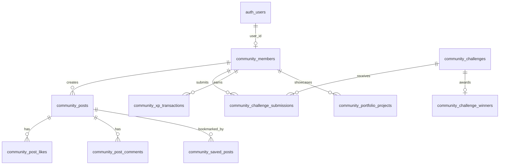

# TNCC — Database Architecture & Schema Audit

**Audit Date:** November 3, 2026  
**Target Engine:** Supabase PostgreSQL 15  
**Active Migration Files:**
1. `supabase/migrations/001_initial_schema.sql` (Initial Marketplace / Agency Schema)
2. `supabase/migrations/002_community_platform.sql` (Member Community Platform Schema)

---

## 1. Schema Overview

The database is divided into two distinct domains:
1. **Legacy Agency & Marketplace Domain (001):** Tables for agency clients, proposals, packages, freelance contracts, and reviews.
2. **Community Platform Domain (002):** Tables for member creators, feeds, challenges, competition winners, XP ledger, portfolio showcase, job board, and events.



---

## 2. Table-by-Table Inventory (Community Domain)

### `community_members`
- **Purpose:** Primary creator profiles for the community platform.
- **Primary Key:** `id` (UUID, default `uuid_generate_v4()`)
- **Foreign Keys:** `user_id` -> `auth.users(id)` ON DELETE CASCADE
- **Key Columns:** `member_id` (TEXT, UNIQUE), `username` (TEXT, UNIQUE), `full_name`, `avatar_url`, `cover_url`, `bio`, `location`, `skills` (TEXT[]), `total_xp` (INTEGER, default 50), `role` (TEXT, check `'member' | 'admin'`).
- **RLS Status:** ENABLED.
- **Current Policies:**
  - `Public read community_members` (FOR SELECT USING true).
  - **GAP:** No `INSERT`, `UPDATE`, or `DELETE` policies defined.

### `community_posts`
- **Purpose:** Main social feed posts published by creators.
- **Primary Key:** `id` (UUID)
- **Foreign Keys:** `member_id` -> `community_members(id)` ON DELETE CASCADE
- **Key Columns:** `caption`, `media_url`, `media_type` ('image', 'video', 'none'), `aspect_ratio`, `hashtags`, `category`, `is_showcase`, `likes_count`, `comments_count`, `saves_count`.
- **RLS Status:** ENABLED.
- **Current Policies:**
  - `Public read community_posts` (FOR SELECT USING true).
  - **GAP:** No `INSERT` policy for author, no `UPDATE` policy for author/likes, no `DELETE` policy for author/admin.

### `community_post_likes`
- **Purpose:** Post like tracking and anti-duplicate enforcement.
- **Primary Key:** `id` (UUID)
- **Foreign Keys:** `post_id` -> `community_posts(id)`, `member_id` -> `community_members(id)`
- **Constraints:** `UNIQUE (post_id, member_id)`
- **RLS Status:** ENABLED.
- **Current Policies:**
  - `Public read community_post_likes` (FOR SELECT USING true).
  - **GAP:** No `INSERT` policy (to like) or `DELETE` policy (to unlike).

### `community_post_comments`
- **Purpose:** Creator discussion comments on posts.
- **Primary Key:** `id` (UUID)
- **Foreign Keys:** `post_id` -> `community_posts(id)`, `member_id` -> `community_members(id)`
- **Key Columns:** `comment_text`, `created_at`.
- **RLS Status:** ENABLED.
- **Current Policies:**
  - `Public read community_post_comments` (FOR SELECT USING true).
  - **GAP:** No `INSERT` or `DELETE` policies.

### `community_saved_posts`
- **Purpose:** Bookmarked posts saved by members.
- **Primary Key:** `id` (UUID)
- **Foreign Keys:** `post_id` -> `community_posts(id)`, `member_id` -> `community_members(id)`
- **Constraints:** `UNIQUE (post_id, member_id)`
- **RLS Status:** ENABLED.
- **Current Policies:**
  - None explicitly defined in 002.
  - **GAP:** Private bookmarks should only be readable and mutable by the bookmark owner (`auth.uid() = member.user_id`).

### `community_resources`
- **Purpose:** Curated creative library (fonts, PSDs, website links, tools).
- **Primary Key:** `id` (UUID)
- **Key Columns:** `title`, `description`, `category`, `resource_type`, `thumbnail_url`, `external_url`, `is_google_drive`, `download_count`.
- **RLS Status:** ENABLED.
- **Current Policies:**
  - `Public read community_resources` (FOR SELECT USING true).
  - **GAP:** No admin-only `INSERT`, `UPDATE`, `DELETE` policies.

### `community_challenges`
- **Purpose:** Creative design and video competitions.
- **Primary Key:** `id` (UUID)
- **Key Columns:** `title`, `description`, `category`, `thumbnail_url`, `prizes` (JSONB), `xp_reward`, `bonus_xp_first`, `bonus_xp_second`, `bonus_xp_third`, `submission_deadline`, `status` ('Upcoming', 'Active', 'Submission Closed', 'Completed').
- **RLS Status:** ENABLED.
- **Current Policies:**
  - `Public read community_challenges` (FOR SELECT USING true).
  - **GAP:** No admin-only `INSERT`, `UPDATE`, `DELETE` policies.

### `community_challenge_submissions`
- **Purpose:** Entries submitted by creators for competitions.
- **Primary Key:** `id` (UUID)
- **Foreign Keys:** `challenge_id` -> `community_challenges(id)`, `member_id` -> `community_members(id)`
- **Constraints:** `UNIQUE (challenge_id, member_id)` (One submission per member per challenge).
- **Key Columns:** `title`, `description`, `submission_type` ('image', 'video', 'pdf', 'gdrive', 'portfolio'), `submission_url`.
- **RLS Status:** ENABLED.
- **Current Policies:**
  - `Public read community_challenge_submissions` (FOR SELECT USING true).
  - **GAP:** No `INSERT` policy for participant, no `UPDATE` policy before deadline.

### `community_challenge_winners`
- **Purpose:** Official competition winners podium.
- **Primary Key:** `id` (UUID)
- **Foreign Keys:** `challenge_id` -> `community_challenges(id)`, `first_place_member_id`, `second_place_member_id`, `third_place_member_id`.
- **Constraints:** `UNIQUE (challenge_id)`.
- **RLS Status:** ENABLED.
- **Current Policies:**
  - `Public read community_challenge_winners` (FOR SELECT USING true).
  - **GAP:** No admin-only `INSERT`/`UPDATE` policies.

### `community_xp_transactions`
- **Purpose:** Immutable audit ledger for member XP earnings.
- **Primary Key:** `id` (UUID)
- **Foreign Keys:** `member_id` -> `community_members(id)`
- **Constraints:** `UNIQUE (member_id, reason, reference_id)` (Strict anti-farming protection).
- **Key Columns:** `amount`, `reason`, `reference_id`, `created_at`.
- **RLS Status:** ENABLED.
- **Current Policies:**
  - None defined in 002.
  - **GAP:** Needs SELECT policy for member's own records and admin, plus secure system-only INSERT via PostgreSQL function.

---

## 3. Database Functions & Triggers

### Existing Triggers (from `001_initial_schema.sql`)
1. `handle_new_user()`: Automatically inserts a row into `profiles` on `auth.users` insert.
2. `update_updated_at_column()`: Automatically updates `updated_at` timestamps on row updates.

### Missing Critical Triggers & Functions (for Community Domain)
1. **Community Member Provisioning Trigger:** When a new user signs up in `auth.users`, a corresponding record must be created in `community_members` with a generated member ID (e.g. `TNCC-2026-XXXX`).
2. **Atomic XP Awarding Function (`award_member_xp`):**
   ```sql
   CREATE OR REPLACE FUNCTION award_member_xp(
     p_member_id UUID,
     p_amount INTEGER,
     p_reason TEXT,
     p_reference_id TEXT
   ) RETURNS VOID AS $$
   BEGIN
     INSERT INTO community_xp_transactions (member_id, amount, reason, reference_id)
     VALUES (p_member_id, p_amount, p_reason, p_reference_id)
     ON CONFLICT (member_id, reason, reference_id) DO NOTHING;
     
     IF FOUND THEN
       UPDATE community_members
       SET total_xp = total_xp + p_amount
       WHERE id = p_member_id;
     END IF;
   END;
   $$ LANGUAGE plpgsql SECURITY DEFINER;
   ```
3. **Admin Verification Function (`is_admin()`):**
   ```sql
   CREATE OR REPLACE FUNCTION is_admin() RETURNS BOOLEAN AS $$
   BEGIN
     RETURN (
       auth.jwt() ->> 'email' = 'suganeshsugu07@gmail.com'
       OR EXISTS (
         SELECT 1 FROM community_members
         WHERE user_id = auth.uid() AND role = 'admin'
       )
     );
   END;
   $$ LANGUAGE plpgsql SECURITY DEFINER;
   ```

---

## 4. Security & Integrity Gaps

| Severity | Table / Component | Gap Description | Fix Required |
|---|---|---|---|
| **CRITICAL** | All `community_*` tables | Zero write policies (`INSERT`/`UPDATE`/`DELETE`). Any live frontend call will fail with 42501 permission error. | Create migration `003_community_rls_policies.sql`. |
| **HIGH** | `community_saved_posts` | Missing SELECT policy; if RLS is enabled without SELECT, members cannot read bookmarks. | Add policy `auth.uid() = (SELECT user_id FROM community_members WHERE id = member_id)`. |
| **HIGH** | `community_members` | Role can theoretically be set to `'admin'` if INSERT/UPDATE policies are not restricted. | Add CHECK constraint or trigger preventing non-admins from writing `role = 'admin'`. |
| **MEDIUM** | Storage Buckets | No migration for Supabase Storage buckets (`community-media`, `challenge-submissions`). | Add storage schema and RLS policies in migration. |
