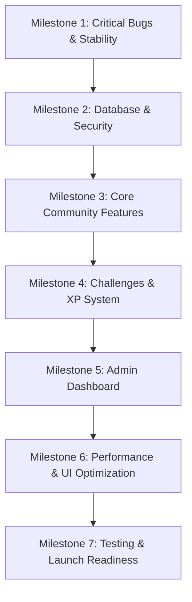

# TNCC — Implementation Roadmap

This roadmap organizes the development, stabilization, and launch readiness of the Tamil Nadu Creators Club (TNCC) website and community platform into 7 logical milestones.

---

## Roadmap Overview

---

## Milestone 1: Critical Bugs & Stability

**Goal:** Eliminate immediate security hazards, broken navigation links, and missing statutory pages.

- **Tasks:**
  - Remove all hardcoded plain-text passwords and password leakage in error messages (`tncc-community/lib/community-db.ts`).
  - Add server-side Next.js Middleware route guard protecting `/community/admin`.
  - Fix `#about` anchor link in `components/sections/CommunityStory.tsx` by adding `id="about"`.
  - Create branded `/privacy` and `/terms` static pages to fix 404 links in Footer.
- **Related Issues:** ISSUE-01, ISSUE-02, ISSUE-07
- **Dependencies:** None
- **Priority:** **P0 – Critical**
- **Completion Criteria:**
  - No plain-text passwords in source code.
  - `/community/admin` redirects unauthenticated requests with HTTP 307.
  - `#about`, `/privacy`, and `/terms` resolve with HTTP 200 without broken links.
- **Testing Requirements:**
  - Manual curl probe on `/community/admin`.
  - Codebase grep for `Suganesh@tncc`.
  - Click-through test of all footer links.

---

## Milestone 2: Database & Security Consolidation

**Goal:** Establish unified Supabase Auth and complete PostgreSQL Row Level Security (RLS) policies.

- **Tasks:**
  - Consolidate legacy auth (`lib/user-context.tsx`) and community auth (`tncc-community/lib/community-context.tsx`) into a single Supabase Auth client.
  - Create and apply SQL migration `003_community_rls_policies.sql` with full `INSERT`, `UPDATE`, and `DELETE` RLS rules for all 14 `community_*` tables.
  - Implement SQL helper function `is_admin()` checking `auth.jwt() ->> 'email' = 'suganeshsugu07@gmail.com'` or role table.
  - Configure Supabase Storage bucket `community-media` with RLS read/write rules.
- **Related Issues:** ISSUE-03, ISSUE-04
- **Dependencies:** Milestone 1
- **Priority:** **P0 – Critical**
- **Completion Criteria:**
  - All user sign-ups and logins generate valid Supabase JWT sessions.
  - PostgreSQL rejects unauthorized writes with RLS violations.
  - Super Admin role is anchored strictly in database/JWT claims.
- **Testing Requirements:**
  - Automated database policy unit tests using pgTAP or Supabase CLI.
  - Token-authenticated API mutation tests.

---

## Milestone 3: Core Community Features (Live Data)

**Goal:** Connect the community feed, post composer, media uploads, and member interactions to Supabase.

- **Tasks:**
  - Connect `useCommunity()` post fetching and creation to `community_posts` table.
  - Implement direct file upload in `FeedComposer.tsx` for images (≤1 MB) and videos (≤50 MB) uploading to Supabase Storage.
  - Connect likes, comments, and saves to `community_post_likes`, `community_post_comments`, and `community_saved_posts`.
  - Wire automatic portfolio mapping to `community_portfolio_projects`.
- **Related Issues:** ISSUE-05, ISSUE-06
- **Dependencies:** Milestone 2
- **Priority:** **P0 – Critical**
- **Completion Criteria:**
  - Users on different devices can see newly published posts in real time.
  - 1 MB image limit and 50 MB video limit are strictly validated on the client and server.
  - Likes, comments, and saved posts persist across sessions.
- **Testing Requirements:**
  - Upload boundary testing (0.9 MB vs 1.1 MB image; 49 MB vs 51 MB video).
  - Multi-user cross-browser feed verification.

---

## Milestone 4: Challenges & XP System Integrity

**Goal:** Connect creative competitions, submissions, and XP calculation to the database with anti-farming safeguards.

- **Tasks:**
  - Connect `/community/challenges` to `community_challenges` table.
  - Implement challenge submission with file upload or external URL format selection.
  - Enforce one submission per user and block submissions after `submission_deadline`.
  - Implement secure server-side XP transactions in `community_xp_transactions` with database unique constraints to prevent double-awarding.
  - Connect `/community/leaderboard` to a real-time sorted query on `community_members(total_xp)`.
- **Related Issues:** ISSUE-08, ISSUE-09
- **Dependencies:** Milestone 3
- **Priority:** **P1 – High**
- **Completion Criteria:**
  - Submitting an entry awards +15 XP only once per user per challenge.
  - Expired challenges reject new submissions.
  - Leaderboard automatically updates as members earn XP.
- **Testing Requirements:**
  - Attempt concurrent/duplicate submission requests.
  - Verify self-likes do not grant XP.

---

## Milestone 5: Admin Dashboard Live Management

**Goal:** Wire the administrative workspace to live database actions with Super Admin role enforcement.

- **Tasks:**
  - Wire challenge creation, editing, and deletion to `community_challenges`.
  - Wire resource library creation and downloads to `community_resources`.
  - Build submission review interface with winner selection (1st, 2nd, 3rd place).
  - Automate winner bonus XP distribution (+100, +60, +30 XP) upon winner announcement.
  - Connect event and job offer management to `community_events` and `community_job_offers`.
- **Related Issues:** ISSUE-10
- **Dependencies:** Milestone 4
- **Priority:** **P1 – High**
- **Completion Criteria:**
  - Super Admin (`suganeshsugu07@gmail.com`) can publish a challenge and see it live immediately for all members.
  - Winner announcement updates challenge status to `Completed` and renders podium on details page.
- **Testing Requirements:**
  - End-to-end admin flow: create challenge -> submit as test user -> pick winner as admin -> verify winner receives bonus XP.

---

## Milestone 6: Performance, UI & Responsive Polish

**Goal:** Optimize media loading, responsive behavior across mobile viewports, and 3D asset bundle size.

- **Tasks:**
  - Remove unused 14 MB `regional_map_logo (3).glb` file from root and public folder.
  - Compress active `regional_map_logo.glb` (currently 4.39 MB) using Draco/meshopt compression.
  - Audit and refine responsiveness at standard breakpoints:
    - Desktop: 1440px
    - Laptop: 1280px
    - Tablet: 768px
    - Mobile: 390px
    - Small Mobile: 360px
  - Verify font preloading and zero layout shifts (CLS).
- **Related Issues:** ISSUE-11
- **Dependencies:** Milestone 5
- **Priority:** **P2 – Medium**
- **Completion Criteria:**
  - Repository size reduced by >14 MB.
  - Mobile Lighthouse score ≥ 90 for performance and best practices.
  - No horizontal overflow on 360px devices.
- **Testing Requirements:**
  - Chrome DevTools device mode emulation at 360px, 390px, 768px, 1280px, 1440px.

---

## Milestone 7: Testing, Quality Assurance & Launch Readiness

**Goal:** Establish automated regression tests, execute full end-to-end user journeys, and verify deployment.

- **Tasks:**
  - Install Playwright and create automated test suites for public pages, auth, feed, challenges, and admin.
  - Conduct full smoke test across all 25 user journey steps.
  - Security audit and penetration check on API routes and storage buckets.
  - Verify production build (`npm run build`) and environment variable configuration.
- **Related Issues:** ISSUE-12
- **Dependencies:** Milestone 6
- **Priority:** **P2 – Medium**
- **Completion Criteria:**
  - 100% passing automated test suite (`npm run test:e2e`).
  - Production build succeeds with 0 warnings.
  - Ready for public launch announcement.
- **Testing Requirements:**
  - Execution of complete 25-step smoke test report with zero critical blockers.

