# TNCC — Prioritized Next Steps & Action Plan

This document serves as the operational guide for developers continuing work on the Tamil Nadu Creators Club (TNCC) platform.

---

## 1. Immediate Next Task

### Task 1.1: Fix Immediate Security Vulnerabilities & Plain-Text Passwords
- **Issue Reference:** `ISSUE-01`
- **Priority:** **P0 – Critical**
- **Files to Modify:**
  - `tncc-community/lib/community-db.ts`
  - `app/community/auth/page.tsx`
- **Actions Required:**
  1. Remove hardcoded strings and credentials from `community-db.ts`.
  2. Eliminate the password-leaking error toast (`"Incorrect admin password..."`).
  3. Replace with a secure, generic authentication failure message: `"Invalid email or password."`.
- **Acceptance Criteria:**
  - Codebase grep for hardcoded admin credentials returns 0 occurrences.
  - Invalid credentials show generic error message.

---

## 2. Critical Pending Tasks (In Priority Order)

### Task 1.2: Server-Side Route Guard for `/community/admin`
- **Issue Reference:** `ISSUE-02`
- **Priority:** **P0 – Critical**
- **Files to Modify:**
  - `middleware.ts`
  - `lib/supabase/middleware.ts`
- **Actions Required:**
  1. Include `/community/admin` in `protectedPaths`.
  2. In `updateSession(request)`, verify that the authenticated user possesses the Super Admin role (`suganeshsugu07@gmail.com`) before allowing access.
  3. Redirect non-admin or unauthenticated requests to `/community/auth` with HTTP 307.

### Task 1.3: Fix Landing Page `#about` Anchor & Missing Statutory Pages
- **Issue Reference:** `ISSUE-07`
- **Priority:** **P1 – High**
- **Status:** **COMPLETED (Issue #7)**
- **Files Modified:**
  - `components/sections/CommunityStory.tsx` (`id="about"`)
  - `components/sections/StackingCards.tsx` (`id="community-guidelines"`)
  - `app/globals.css` (`scroll-margin-top: 80px`)
  - `components/layout/Navbar.tsx`, `components/layout/MobileMenu.tsx`, `components/layout/Footer.tsx` (`/#about`, etc.)
  - `app/privacy/page.tsx` (Complete 14-section policy)
  - `app/terms/page.tsx` (Complete 16-section terms)

### Task 2.1: Supabase RLS Migration for Community Platform
- **Issue Reference:** `ISSUE-04`
- **Priority:** **P0 – Critical**
- **Files to Modify:**
  - `supabase/migrations/003_community_rls_policies.sql`
- **Actions Required:**
  1. Write and apply granular `INSERT`, `UPDATE`, and `DELETE` policies for `community_posts`, `community_post_likes`, `community_post_comments`, `community_resources`, `community_challenges`, `community_challenge_submissions`, and `community_xp_transactions`.
  2. Define `is_admin()` helper function checking email `suganeshsugu07@gmail.com`.

### Task 2.2: Migrate Community Auth from LocalStorage to Supabase Auth
- **Issue Reference:** `ISSUE-03`
- **Priority:** **P0 – Critical**
- **Files to Modify:**
  - `tncc-community/lib/community-context.tsx`
  - `tncc-community/lib/community-db.ts`
  - `app/community/auth/page.tsx`
- **Actions Required:**
  1. Replace local mock registration with `supabase.auth.signUp`.
  2. Replace local mock login with `supabase.auth.signInWithPassword`.
  3. On successful signup, insert creator record into `community_members`.

---

## 3. Tasks Blocked by Dependencies

| Blocked Task | Required Dependency | Reason |
|---|---|---|
| Direct File Upload (1 MB / 50 MB) | Direct Storage & Auto Preview (`ISSUE-06`) | **COMPLETED in Issue #6**: Added `/api/community/upload` with strict 1 MB image & 50 MB video limits, MIME whitelist, drag-and-drop FeedComposer, Google Drive preview engine, responsive video player with viewport autoplay, and migration `006_storage_buckets_and_media.sql`. |
| Multi-Device Community Feed Sync | Unified Supabase Auth (`ISSUE-03`) & RLS (`ISSUE-04`) | Posts cannot be inserted to PostgreSQL until real authenticated user sessions are established. |
| Live Admin Challenge & Winner Announcements | Admin Route Middleware (`ISSUE-02`) & RLS (`ISSUE-04`) | **COMPLETED in Issue #10**: Middleware route guard and server API routes `/api/community/admin/*` operational with 401/403 authorization; Migration `003_community_admin_and_rls.sql` prepared for database execution. |
| Enforce Challenge Submission Rules & Deadlines | Server-side validation (`ISSUE-09`) | **COMPLETED in Issue #9**: Added `/api/community/challenges/submit` with server UTC deadline checks, mutex locking, duplicate prevention, and migration `004_challenge_submissions_and_deadlines.sql`. |
| Server-Side XP Ledger & Anti-Farming | Server routes & RPC (`ISSUE-08`) | **COMPLETED in Issue #8**: Added `/api/community/xp/*`, `/api/community/posts`, `/api/community/posts/[id]/like`, anti-farming self-like denial, mutex locks, and migration `005_xp_transaction_ledger_and_antifarming.sql`. |

---

## 4. Recommended Implementation Order

```mermaid
flowchart LR
    Step1["1. Fix Passwords & Error Leak (ISSUE-01)"] --> Step2["2. Middleware Guard for Admin (ISSUE-02)"]
    Step2 --> Step3["3. Fix #about Anchor & Legal Pages (ISSUE-07)"]
    Step3 --> Step4["4. Deploy Community RLS Migration (ISSUE-04)"]
    Step4 --> Step5["5. Wire Supabase Auth (ISSUE-03)"]
    Step5 --> Step6["6. Connect Feed & Direct File Upload (ISSUE-05, ISSUE-06)"]
    Step6 --> Step7["7. Live Challenges & Admin Sync (ISSUE-08, ISSUE-09, ISSUE-10)"]
    Step7 --> Step8["8. 3D Asset Optimization & Playwright E2E (ISSUE-11, ISSUE-12)"]
```

