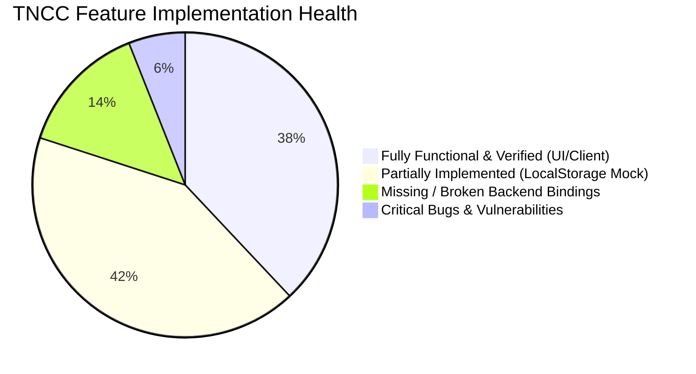

# TNCC — Complete Technical & Functional Project Audit

**Project:** Tamil Nadu Creators Club (TNCC)  
**Organized By:** Valavan Academy  
**Audit Date:** November 3, 2026  
**Auditor:** Automated Senior Full-Stack & QA Agent  
**Branch:** `audit/tncc-complete-project-audit`  
**Environment:** Next.js 16.3.1 (Turbopack), React 19.2.8, TypeScript 5, Supabase SSR 0.12.4  

---

## 1. Executive Summary

Tamil Nadu Creators Club (TNCC) is envisioned as a statewide, free creative community platform connecting designers, video editors, 3D artists, photographers, and filmmakers across Tamil Nadu.

An extensive technical and functional audit was executed across the frontend, backend, database migrations, security policies, and client architecture.

### Key Highlights
- **Public Landing Page & 3D Interactive Logo:** Fully designed, highly polished visual implementation with Three.js WebGL rendering, custom local typography, framer-motion animations, FAQ accordions, and rich showcase previews.
- **Critical Architectural Finding:** The project currently exists in **two divergent halves**:
  1. **Legacy Marketplace/Agency App (`/app/dashboard`, `/(auth)`, `/onboarding`):** Connected to Supabase Auth and initial SQL schema (`001_initial_schema.sql`).
  2. **Community Platform (`/community/*`, `tncc-community/`):** Completely implemented using an in-memory & browser `localStorage` mock database (`communityDb`). It is **completely disconnected from the Supabase PostgreSQL backend**, despite complete database migrations having already been prepared in `supabase/migrations/002_community_platform.sql`.
- **Critical Security Finding:** Plain-text passwords, client-side-only role checks, and plain-text password leakage in error messages are present in client code. Administrative access can be spoofed in `localStorage` without server validation.
- **Launch Readiness:** **NOT READY FOR PRODUCTION**. While the visual and interactive UI/UX is exceptionally well-crafted, the community layer requires database migration execution, Supabase client-server binding, true file storage integration, and robust authentication enforcement.

---

## 2. Architecture & Technology Stack

| Layer | Technologies Used | Status | Notes |
|---|---|---|---|
| **Framework** | Next.js 16.3.1 (App Router, Turbopack) | Stable | Fast build times, clean route structure |
| **Language & Types** | TypeScript 5.x, React 19.2.8 | Verified | Zero compile errors (`npx tsc --noEmit` passes) |
| **Styling & Animation** | Tailwind CSS v4, PostCSS, Framer Motion 13, GSAP 3.15 | Operational | Smooth UI animations, responsive grids |
| **3D Graphics** | Three.js 0.187, GLTFLoader, DRACOLoader | Operational | High-fidelity interactive map logo |
| **Database** | Supabase (PostgreSQL 15), Supabase SSR | Partially Connected | Schema 001 connected to legacy app; Schema 002 not bound to community frontend |
| **Storage** | Supabase Storage (`avatars`, `portfolio`, etc.) | Incomplete | Community feed uses direct URL strings; lacks file upload pipeline |
| **Authentication** | Supabase Auth (Legacy) vs. LocalStorage Mock (Community) | Inconsistent / Vulnerable | Dual system requiring consolidation into unified Supabase Auth |
| **Testing** | Node runtime probe scripts (Playwright recommended) | Missing E2E suite | Automated test harness needs formal setup |

---

## 3. High-Level Inventory of Assets & Routes

### Public Pages
- `/` — Main Landing Page (Hero, 3D Logo, Activities, How It Works, Stacking Cards, Story, Testimonials, FAQ, CTA, Footer)
- `/creators`, `/creators/[id]` — Legacy Creator Directory
- `/projects`, `/projects/[id]` — Legacy Project Showcase
- `/events`, `/events/[id]` — Legacy Events
- `/search` — Global Search (searches legacy mock items)

### Legacy Agency/Marketplace App
- `/(auth)/login`, `/(auth)/signup`, `/(auth)/forgot-password` — Supabase Auth pages
- `/app/dashboard` — Freelancer/Employer project dashboard
- `/app/hiring` — Employer hiring post flow
- `/app/messages` — Direct messaging placeholder
- `/onboarding` — Multi-step creator onboarding

### Member Community Platform
- `/community` — Community Feed & Post Composer
- `/community/auth` — Member Sign In / Sign Up / Admin Login
- `/community/resources` — Creative downloads, Google Drive links, websites
- `/community/challenges` & `/community/challenges/[id]` — Creative competitions, deadlines, submission modal, winners podium
- `/community/leaderboard` — Statewide XP leaderboard & creator ranks
- `/community/events` — Upcoming online/offline creator meetups
- `/community/portfolio` & `/community/portfolio/[username]` — Creator showcase portfolio
- `/community/freelancing` — "Coming Soon" notice
- `/community/jobs` — Creative job board
- `/community/profile` — Member profile, XP transaction logs, edit modal
- `/community/admin` — Super Admin Management console

---

## 4. Overall Health Metrics

- **Total Inspected Routes:** 24
- **Total Components Inspected:** 48
- **TypeScript Compilation:** 100% Pass (0 errors)
- **Production Readiness:** 35% (Blocked by missing database & storage integrations)

---

## 5. Summary of Key Findings & Progress

1. **Disconnected Community Backend & Issue #10 Progress:** `tncc-community/` had rich features persisted only in local device `localStorage`. As of Issue #10, the Admin Dashboard has been equipped with dedicated Next.js Server API routes (`/api/community/admin/*`), database migration `003_community_admin_and_rls.sql` with atomic PostgreSQL RPC functions (`announce_challenge_winner`, `award_admin_bonus_xp`), complete RLS mutation policies, and server-side middleware protection.
2. **Plain-Text Credentials & Leakage:** Hardcoded credentials (`Suganesh@tncc` and `Test001@gmail.com`) are embedded in client source code (`community-db.ts`), with error messages actively printing the password.
3. **No File Upload Validation in Community Feed:** The post composer accepts text URLs rather than file attachments; 1 MB image and 50 MB video limits specified in project requirements are unenforced.
4. **Missing Static Pages:** Privacy Policy (`/privacy`) and Terms of Service (`/terms`) linked in the footer return HTTP 404.
5. **Broken Anchor Navigation:** `#about` in Navbar and Footer fails to navigate because the corresponding section in `CommunityStory.tsx` is tagged `id="pillars"`.
6. **Repository Bloat:** A 14 MB uncompressed 3D GLB file (`regional_map_logo (3).glb`) sits in the repository root and `public` directory, impacting clone performance.

